# Dashboard de Assessment Unifique (`Unifique`) — Documentação técnica e funcional

> Repositório: `Cia-Talentos-DataHub/Unifique` (**público**, 729 commits: 681 automáticos do GitHub Actions e 48 do desenvolvedor Lucas Moreira). Site estático publicado no **GitHub Pages** (`https://cia-talentos-datahub.github.io/Unifique/`) que mostra, por participante, o resultado do **assessment do cliente Unifique**: notas de competências da entrevista, texto da entrevista, plano de desenvolvimento sugerido, perfil **Facet5** e **questionário de carreira**. Um **GitHub Actions** baixa as planilhas e PDFs do SharePoint a cada 6 horas, converte tudo em JSON e faz *commit* dos dados no próprio repositório. Escrito para que alguém que nunca viu o sistema entenda o negócio e consiga **recriá-lo do zero**.

## 1. O que é e para quem serve
**Problema de negócio.** A CT conduziu um projeto de assessment de lideranças da Unifique (entrevistas por competência + Facet5 + questionário de carreira). Os resultados individuais precisam chegar ao próprio participante e à diretoria dele sem enviar PDFs e planilhas por e-mail. O painel organiza tudo por pessoa e controla **quem vê quem**.

| Perfil | Acesso |
|---|---|
| **Nível 1** | Vê todos os participantes (equipe CT / gestão do projeto). Também vê o botão "Atualizar agora". |
| **Nível 2** | Diretor: vê os participantes da própria **diretoria** (e a si mesmo). |
| **Nível 3** | Participante: vê só o próprio relatório. |
| **Nível 4** | Vê todos **exceto** uma lista fixa de nomes (bloqueio no código). |

## 2. Glossário
| Termo | Significado |
|---|---|
| **Participante** | Pessoa avaliada; também é o "usuário" do login. |
| **Diretoria / Diretor** | Agrupamento organizacional; define a visibilidade do nível 2. |
| **Competência** | Dimensão avaliada na entrevista (descrição, indicadores, perguntas, respostas, conclusão, nota e média da competência). |
| **Facet5** | Instrumento de personalidade: 5 fatores (Determinação, Energia, Afetividade, Controle, Emocionalidade) + "Família de referência". |
| **Questionário de Carreira** | Respostas em XLSX (um arquivo por participante). |
| **Cardápio de Ações** | Planilha com ações de desenvolvimento por competência e por faixa de nota (abaixo / atende plenamente / supera). |
| **PBKDF2** | Função que gera o hash de senha (SHA-256, 200.000 iterações, salt de 16 bytes). |

## 3. Fluxos

```mermaid
flowchart LR
  SP[(SharePoint: planilhas e pastas via link público)] -->|fetch_sharepoint.py| IN[_input/]
  IN -->|pdf_to_xlsx.py: PDFs Facet5 + XLSX Carreira| X[facet.xlsx e questionarios.xlsx]
  IN & X -->|build.py| J[data/*.json: access, interviews, facet, career, actions, manifest]
  J -->|git commit pelo bot| GH[(repositório)]
  GH --> PG[GitHub Pages]
  PG --> U[Participante / Diretor / Gestão]
  U -->|botão Atualizar agora| W[Cloudflare Worker] -->|workflow_dispatch com PAT| GA[GitHub Actions]
```

Agenda: `cron 0 */6 * * *` (UTC) ou disparo manual. A interface faz *polling* de `manifest.json` (a cada 5 s, até 5 min) até `generated_at` mudar.

## 4. Arquitetura, stack e arquivos
- **Front-end**: HTML + CSS + JavaScript em módulos ES (sem build), **Plotly.js** por CDN. Sem framework.
- **Dados**: arquivos JSON versionados em `data/` (a "base de dados" é o próprio Git).
- **ETL**: Python 3.11 (`pandas`, `openpyxl`, `pdfplumber`, `requests`) + `poppler-utils` (`pdftotext`).
- **Proxy**: Cloudflare Worker (`worker/`) que guarda o PAT do GitHub e dispara o workflow.

| Arquivo | Papel |
|---|---|
| `index.html`, `css/style.css`, `assets/` | Tela de login e do dashboard; logos Unifique. |
| `js/main.js` | Orquestra login, filtros (diretor, cargo, competência, pessoa), abas, botão de sincronização. |
| `js/auth.js` | Verificação de senha PBKDF2 no navegador (`crypto.subtle`). |
| `js/access.js` | Regras de visibilidade por nível. |
| `js/data.js` | Carrega os JSONs. |
| `js/charts.js` | Abas Competências, Entrevista, Desenvolvimento, Facet5 e Carreira. |
| `js/config.js` | Dados do repositório e URL/chave do Worker. |
| `scripts/fetch_sharepoint.py` | Baixa arquivos/pastas do SharePoint por links "qualquer pessoa com o link". |
| `scripts/pdf_to_xlsx.py` | Extrai texto dos PDFs Facet5 e consolida os XLSX de carreira. |
| `scripts/build.py` | Gera os JSONs, faz *fuzzy matching* de nomes e os hashes de senha. |
| `scripts/list_credentials.py` | Diagnóstico: lista as senhas válidas por diretor lendo a planilha. |
| `.github/workflows/sync-sharepoint.yml` | Automação de sincronização. |
| `worker/` | `worker.js`, `wrangler.toml`, guia de deploy. |
| `test_*.mjs` | Scripts de teste (`test_login.mjs` está vazio: "teste removido"). |

## 5. Variáveis de ambiente e segredos
| Onde | Nome | Uso |
|---|---|---|
| GitHub Actions (secrets) | `SP_FILE_ACESSOS`, `SP_FILE_ENTREVISTAS`, `SP_FILE_CARDAPIO`, `SP_FOLDER_FACET`, `SP_FOLDER_CARREIRA` | Links SharePoint (o script tem **valores padrão embutidos**, ver §12). |
| Build | `BUILD_INPUT_DIR`, `BUILD_OUTPUT_DIR` | Entrada e saída do `build.py`. |
| Cloudflare Worker | `GH_PAT` (secret), `TRIGGER_KEY` (secret), `GH_OWNER`, `GH_REPO`, `GH_WORKFLOW`, `GH_BRANCH`, `ALLOWED_ORIGIN` | Disparo do workflow. |
| Front-end (`config.js`, público) | `workerUrl`, `triggerKey` | Chamada ao Worker. |

## 6. Banco de dados
Sem banco: JSONs em `data/`.
| Arquivo | Conteúdo (campos principais) |
|---|---|
| `access.json` | 30 registros: `PARTICIPANTE`, `EMAIL`, `CARGO`, `DIRETOR`, `DIRETORIA`, `__access_level__`, `__participant_key__`, `__password_hash__ {salt, iterations, hash}`. |
| `interviews.json` | 216 registros (participante × competência): descrição, indicadores, perguntas, respostas, conclusões, `Nota`, `MediaCompetencia`. |
| `facet.json` | 30 registros: família, perfil e, para cada fator, nota e descrição. |
| `career.json` | 510 registros (formato longo): `Participante`, `Pergunta`, `Resposta`. |
| `actions.json` | Cardápio por competência e por faixa. |
| `manifest.json` | `generated_at`, colunas usadas, arquivos de origem, contagens, iterações PBKDF2. |

## 7. Autenticação e autorização
- Login: o participante **escolhe o nome** numa lista (que contém todos os nomes do `access.json`, visível sem login) e digita a senha; o navegador deriva PBKDF2 (SHA-256, salt do registro) e compara com o hash.
- A senha de cada pessoa vem da coluna `SENHA` da planilha de acessos; o `build.py` só publica o hash.
- O nível vem da coluna `Acesso_Relatório`. A visibilidade é aplicada **no navegador** sobre JSONs que já foram baixados completos.
- **Toda a segurança é do lado do cliente.** Os JSONs, inclusive de quem o usuário não pode ver, são públicos (ver §12).

## 8. Interfaces
Páginas: tela de login e dashboard com 5 abas. Filtros: diretor, cargo, competência e participante(s). Nível 1 tem o card de sincronização que chama `POST {workerUrl}/trigger` (cabeçalho `X-Trigger-Key`); o Worker responde 204 em caso de sucesso, 401 sem chave válida.

## 9. Regras de negócio
1. **Origem dos dados**: planilha de acessos (aba `Acessos`), planilha de entrevistas por competência (aba `Entrevistas`), pasta de PDFs Facet5, pasta de XLSX do questionário de carreira, planilha do cardápio de ações.
2. **Junção por nome**: as fontes não compartilham ID; o `build.py` normaliza (sem acento, minúsculas, sem espaços duplos) e usa similaridade de tokens (Jaccard) com limiar **0,5**.
3. **Visibilidade** (código): nível 1 todos; nível 2 `DIRETORIA == nome do logado` (cai para `DIRETOR` se vazio) e sempre inclui a si; nível 3 só si; nível 4 todos menos 3 nomes fixos no código, mantendo o próprio.
4. **Facet5**: o parser lê `pdftotext -layout` com regex para família e 5 fatores (nota e descrição do fluxo de texto), no layout padrão dos relatórios.
5. **Questionário de carreira**: converte o XLSX de cada participante (pergunta em coluna) para formato longo; arquivos são detectados por conteúdo (`is_career_xlsx_deep`).
6. **Desenvolvimento**: a média da competência é mapeada para uma das três faixas do cardápio (abaixo / atende plenamente / supera) e mostra "Como desenvolver", "Como ir além" e "Materiais de apoio".
7. **Atualização**: o bot só faz *commit* se `data/` mudou; mensagem `auto-sync SharePoint <data UTC>`.
8. Se `crypto.subtle` não existir (acesso por HTTP não seguro), o login exibe aviso.

## 10. Roteiro para recriar e checklist
1. Criar o repositório e habilitar GitHub Pages (branch `main`, raiz).
2. Preparar no SharePoint as planilhas (acessos, entrevistas, cardápio) e as pastas (PDFs Facet5, XLSX de carreira).
3. Escrever `fetch_sharepoint.py`, `pdf_to_xlsx.py`, `build.py` e o workflow (Python 3.11, `poppler-utils`).
4. Escrever o front-end: `main.js`, `auth.js`, `access.js`, `charts.js`, `data.js`, `utils.js`, CSS.
5. Publicar o Worker da Cloudflare (PAT *fine-grained* com `Actions: write` apenas neste repositório) e preencher `config.js`.
6. Rodar o workflow manualmente; abrir o site e testar um login por nível.

**Checklist**: [ ] repositório **privado** ou dados protegidos no servidor (§12) · [ ] links do SharePoint nos *secrets* e não no código · [ ] coluna `SENHA` removida da planilha após o *build* · [ ] bloqueio do nível 4 revisado · [ ] PAT com validade e escopo mínimos.

## 11. Apêndices — código-fonte real (links e segredos redigidos)
### 11.1 Workflow `.github/workflows/sync-sharepoint.yml`
```yaml
name: Sync SharePoint → GitHub Pages

on:
  schedule:
    # A cada 6 horas (UTC). Ajuste conforme preferir.
    - cron: "0 */6 * * *"
  workflow_dispatch: {}  # também permite disparar manualmente

permissions:
  contents: write

jobs:
  sync:
    runs-on: ubuntu-latest
    steps:
      - name: Checkout
        uses: actions/checkout@v4

      - name: Setup Python
        uses: actions/setup-python@v5
        with:
          python-version: "3.11"

      - name: Install dependencies
        run: |
          sudo apt-get update -y
          sudo apt-get install -y poppler-utils
          pip install -r scripts/requirements.txt

      - name: Download from SharePoint
        env:
          SP_FILE_ACESSOS: ${{ secrets.SP_FILE_ACESSOS }}
          SP_FILE_ENTREVISTAS: ${{ secrets.SP_FILE_ENTREVISTAS }}
          SP_FILE_CARDAPIO: ${{ secrets.SP_FILE_CARDAPIO }}
          SP_FOLDER_FACET: ${{ secrets.SP_FOLDER_FACET }}
          SP_FOLDER_CARREIRA: ${{ secrets.SP_FOLDER_CARREIRA }}
        run: |
          mkdir -p _input
          python scripts/fetch_sharepoint.py --out _input

      - name: Convert PDFs/XLSX (parser → facet.xlsx + questionarios.xlsx)
        run: |
          python scripts/pdf_to_xlsx.py \
            --facet _input/pdfs_facet5 \
            --career _input/questionarios_carreira \
            --out _input

      - name: Build JSONs
        env:
          BUILD_INPUT_DIR: _input
        run: |
          python scripts/build.py

      - name: Commit data updates
        run: |
          git config user.name "github-actions[bot]"
          git config user.email "41898282+github-actions[bot]@users.noreply.github.com"
          git add data/
          if git diff --staged --quiet; then
            echo "Nada mudou."
          else
            git commit -m "auto-sync SharePoint $(date -u '+%Y-%m-%d %H:%M UTC')"
            git push
          fi
```
### 11.2 `js/auth.js`, `js/access.js` e `js/config.js`
```javascript
// auth.js - validacao de senha contra hash PBKDF2

function hexToBytes(hex) {
  const bytes = new Uint8Array(hex.length / 2);
  for (let i = 0; i < bytes.length; i++) {
    bytes[i] = parseInt(hex.substr(i * 2, 2), 16);
  }
  return bytes;
}

function bytesToHex(buf) {
  return Array.from(new Uint8Array(buf))
    .map((b) => b.toString(16).padStart(2, "0"))
    .join("");
}

export async function verifyPassword(password, spec) {
  if (!spec || !spec.salt || !spec.hash || !spec.iterations) return false;
  const enc = new TextEncoder();
  const keyMaterial = await crypto.subtle.importKey(
    "raw",
    enc.encode(password),
    { name: "PBKDF2" },
    false,
    ["deriveBits"]
  );
  const bits = await crypto.subtle.deriveBits(
    {
      name: "PBKDF2",
      salt: hexToBytes(spec.salt),
      iterations: spec.iterations,
      hash: "SHA-256",
    },
    keyMaterial,
    256
  );
  return bytesToHex(bits) === spec.hash.toLowerCase();
}

/**
 * Login pelo PARTICIPANTE: encontra o registro pelo nome selecionado e valida senha.
 * Retorna o registro de acesso se OK, senão null.
 */
export async function authenticateParticipant(accessRecords, selectedParticipant, typedPassword) {
  const pwd = String(typedPassword || "").trim();
  if (!pwd) return null;

  const target = String(selectedParticipant || "").trim();
  const row = accessRecords.find((r) => String(r.PARTICIPANTE || "").trim() === target);

  if (!row) {
    console.warn("[auth] participante nao encontrado:", target);
    return null;
  }

  if (!crypto || !crypto.subtle) {
    alert(
      "Seu navegador nao expoe crypto.subtle. Acesse o site via http://localhost ou https://."
    );
    return null;
  }

  if (!row.__password_hash__) {
    console.warn("[auth] participante sem senha cadastrada:", target);
    return null;
  }

  const ok = await verifyPassword(pwd, row.__password_hash__);
  console.log(`[auth] participante=${target}  match=${ok}  nivel=${row.__access_level__}`);
  return ok ? row : null;
}

// ---- js/access.js ----
// access.js - aplica filtro de visibilidade conforme nivel de acesso

import { normalizeText } from "./utils.js";

// Nivel 4: ve todos os participantes EXCETO esses nomes (lista bloqueada).
// Edite aqui quando quiser adicionar/remover quem fica fora do nivel 4.
const LEVEL_4_BLOCKLIST = new Set([
  "adriana joice sandri osti",
  "ana paula de oliveira caldas",
  "julio cesar conti",
].map((n) => normalizeText(n)));

/**
 * Acesso 1: ve todos os participantes
 * Acesso 2: ve quem tem DIRETORIA == nome do logado (com fallback DIRETOR == nome)
 * Acesso 3: ve apenas o proprio
 * Acesso 4: ve todos os participantes EXCETO os nomes em LEVEL_4_BLOCKLIST
 *
 * Retorna a lista de PARTICIPANTES (nomes originais) que o usuario logado pode ver.
 */
export function getAllowedParticipants(accessRecords, loggedRow) {
  const level = Number(loggedRow.__access_level__ || 0);
  const me = String(loggedRow.PARTICIPANTE || "").trim();
  const meKey = normalizeText(me);

  if (level === 1) {
    return accessRecords.map((r) => r.PARTICIPANTE).filter(Boolean);
  }

  if (level === 4) {
    const list = accessRecords
      .map((r) => r.PARTICIPANTE)
      .filter(Boolean)
      .filter((name) => !LEVEL_4_BLOCKLIST.has(normalizeText(name)));
    // Garante que o usuario logado sempre se ve, mesmo estando na blocklist
    if (me && !list.includes(me)) list.unshift(me);
    return list;
  }

  if (level === 3) {
    return [me];
  }

  // Acesso 2: tenta DIRETORIA == nome do logado
  let allowed = accessRecords
    .filter((r) => normalizeText(r.DIRETORIA) === meKey)
    .map((r) => r.PARTICIPANTE);

  // Fallback: DIRETOR == nome do logado (caso a planilha use DIRETOR para isso)
  if (!allowed.length) {
    allowed = accessRecords
      .filter((r) => normalizeText(r.DIRETOR) === meKey)
      .map((r) => r.PARTICIPANTE);
  }

  // Garante que o proprio diretor sempre aparece na lista
  if (!allowed.includes(me)) allowed = [me, ...allowed];

  return allowed;
}

// ---- js/config.js ----
// config.js — configuração da integração com o Cloudflare Worker.
//
// O Worker é o proxy seguro entre o app e o GitHub. O PAT fica armazenado
// nas variáveis do Worker, NUNCA aqui no JS público.
//
// Aqui vão APENAS:
//   - workerUrl:    URL pública do Worker (ex: https://unifique-sync.lucas.workers.dev)
//   - triggerKey:   chave compartilhada (sem segredo real). Só impede que alguém
//                   chame o Worker via curl sem saber dela. Como o Worker só faz UMA
//                   coisa (disparar o workflow), o impacto de vazamento é ZERO.

export const GITHUB = {
  // Identificação do repo (usados também para o link de fallback).
  owner: "cia-talentos-datahub",
  repo: "Unifique",
  workflow_file: "sync-sharepoint.yml",

  // ↓ preencha esses dois depois de fazer o deploy do Worker (ver worker/README.md)
  workerUrl: "https://unifique-sync.lucas-moreira.workers.dev/",
  triggerKey: "<chave-redigida>",
};
```
### 11.3 `worker/worker.js` e `worker/wrangler.toml`
```javascript
/**
 * Cloudflare Worker — Proxy de dispatch para o workflow do Unifique.
 *
 * O frontend chama POST {workerUrl}/trigger com o header X-Trigger-Key.
 * O Worker valida a chave e dispara o workflow no GitHub usando o PAT armazenado
 * nas Environment Variables (NUNCA no código).
 *
 * Variáveis (definir no Cloudflare Dashboard ou via wrangler):
 *   GH_PAT       (secret) → fine-grained PAT com Actions write no repo Unifique
 *   GH_OWNER             → "lucasf-moreira"
 *   GH_REPO              → "Unifique"
 *   GH_WORKFLOW          → "sync-sharepoint.yml"
 *   GH_BRANCH            → "main"
 *   TRIGGER_KEY  (secret) → chave qualquer (ex: "unifique-2026"); o frontend usa a mesma
 *   ALLOWED_ORIGIN       → "https://lucasf-moreira.github.io"  (sem barra final)
 */

const corsHeaders = (origin) => ({
  "Access-Control-Allow-Origin": origin || "*",
  "Access-Control-Allow-Methods": "POST, OPTIONS",
  "Access-Control-Allow-Headers": "Content-Type, X-Trigger-Key",
  "Access-Control-Max-Age": "86400",
});

export default {
  async fetch(request, env) {
    const origin = env.ALLOWED_ORIGIN || "*";

    // Preflight CORS
    if (request.method === "OPTIONS") {
      return new Response(null, { status: 204, headers: corsHeaders(origin) });
    }

    if (request.method !== "POST") {
      return new Response("Use POST", { status: 405, headers: corsHeaders(origin) });
    }

    const url = new URL(request.url);
    if (!url.pathname.endsWith("/trigger")) {
      return new Response("Not found", { status: 404, headers: corsHeaders(origin) });
    }

    // Validação da chave
    const key = request.headers.get("X-Trigger-Key");
    if (!env.TRIGGER_KEY || key !== env.TRIGGER_KEY) {
      return new Response("Unauthorized", { status: 401, headers: corsHeaders(origin) });
    }

    if (!env.GH_PAT || !env.GH_OWNER || !env.GH_REPO || !env.GH_WORKFLOW) {
      return new Response("Worker mal configurado", { status: 500, headers: corsHeaders(origin) });
    }

    const ghUrl = `https://api.github.com/repos/${env.GH_OWNER}/${env.GH_REPO}/actions/workflows/${env.GH_WORKFLOW}/dispatches`;
    const ghRes = await fetch(ghUrl, {
      method: "POST",
      headers: {
        Authorization: `Bearer ${env.GH_PAT}`,
        Accept: "application/vnd.github+json",
        "X-GitHub-Api-Version": "2022-11-28",
        "Content-Type": "application/json",
        "User-Agent": "unifique-sync-worker",
      },
      body: JSON.stringify({ ref: env.GH_BRANCH || "main" }),
    });

    const body = ghRes.ok ? "ok" : await ghRes.text();
    return new Response(body, {
      status: ghRes.ok ? 204 : ghRes.status,
      headers: { ...corsHeaders(origin), "Content-Type": "text/plain" },
    });
  },
};

// ---- wrangler.toml ----
name = "unifique-sync"
main = "worker.js"
compatibility_date = "2024-09-01"

# Variáveis públicas (não são segredo). Edite conforme seu repo.
[vars]
GH_OWNER = "cia-talentos-datahub"
GH_REPO = "Unifique"
GH_WORKFLOW = "sync-sharepoint.yml"
GH_BRANCH = "main"
ALLOWED_ORIGIN = "https://cia-talentos-datahub.github.io"

# Secrets (NÃO COLOQUE AQUI). Configure via:
#   wrangler secret put GH_PAT
#   wrangler secret put TRIGGER_KEY
# Ou pelo Dashboard: Workers & Pages → seu worker → Settings → Variables → Add encrypted variable
```
### 11.4 `scripts/build.py` (acessos, hashes e entrevistas)
```python
"""
Build script — converte os Excels de origem em JSONs prontos para o frontend.

Saídas em ../data/:
  - access.json       : login (PARTICIPANTE), senhas hasheadas (PBKDF2-SHA256), nível de acesso e mapeamento de visibilidade.
  - interviews.json   : notas, respostas e conclusões por participante x competência (aba "Entrevistas").
  - facet.json        : perfil/família/notas dos 5 fatores (gerado a partir de facet.xlsx, que vem do parser de PDFs).
  - career.json       : respostas dos questionários de carreira (gerado a partir de questionarios.xlsx, do parser de PDFs).
  - manifest.json     : metadados (colunas, contagens, iterações PBKDF2).
"""

from __future__ import annotations

import datetime as _dt
import hashlib
import json
import os
import secrets
from pathlib import Path
from typing import Dict, List, Optional, Tuple

import pandas as pd


SCRIPT_DIR = Path(__file__).resolve().parent
PROJECT_DIR = SCRIPT_DIR.parent
DEFAULT_INPUT_DIR = PROJECT_DIR.parent
DEFAULT_OUTPUT_DIR = PROJECT_DIR / "data"

INPUT_DIR = Path(os.environ.get("BUILD_INPUT_DIR", DEFAULT_INPUT_DIR))
OUTPUT_DIR = Path(os.environ.get("BUILD_OUTPUT_DIR", DEFAULT_OUTPUT_DIR))

ACCESS_FILES = ["acessos.xlsx", "Participantes - Assessment - com diretores.xlsx"]
INTERVIEWS_FILES = ["entrevistas.xlsx", "Planilha_Entrevistas_Competências POWER BI COMPLETO.xlsx"]
FACET_FILES = ["facet.xlsx"]
CAREER_FILES = ["questionarios.xlsx"]
ACTIONS_FILES = ["Cardápio Ações de Desenvolvimento - UNIFIQUE.xlsx", "cardapio.xlsx"]

ACCESS_SHEET_CANDIDATES = ["Acessos", "Acesso", "Planilha1", "Sheet1"]
INTERVIEWS_SHEET_CANDIDATES = ["Entrevistas", "Entrevista", "Planilha1", "Sheet1"]

PARTICIPANT_COLUMN = "PARTICIPANTE"
EMAIL_COLUMN = "E-MAIL"
PASSWORD_COLUMN = "SENHA"
ACCESS_LEVEL_COLUMN = "Acesso_Relatório"
DIRETOR_COLUMN = "DIRETOR"
DIRETORIA_COLUMN = "DIRETORIA"
ROLE_COLUMN = "CARGO"

INTERVIEW_NAME_COLUMN = "Nome do Entrevistado"
INTERVIEW_DIRETORIA = "Diretoria"
INTERVIEW_COMPETENCY = "COMPETÊNCIA"
INTERVIEW_DESCRIPTION = "DESCRIÇÃO DA COMPETÊNCIA"
INTERVIEW_INDICATORS = "INDICADORES"
INTERVIEW_QUESTIONS = "PERGUNTAS PARA ENTREVISTA"
INTERVIEW_ANSWERS = "RESPOSTAS"
INTERVIEW_CONCLUSIONS = "CONCLUSÕES GERAIS SOBRE O PARTICIPANTE"
INTERVIEW_NOTES = "NOTAS"
INTERVIEW_AVERAGE = "MÉDIA GERAL DA COMPETÊNCIA"

FACET_GROUPS = [
    "Determinação",
    "Energia",
    "Afetividade",
    "Controle",
    "Emocionalidade",
]

PBKDF2_ITERATIONS = 200_000
SALT_BYTES = 16


def normalize_text(value) -> str:
    if value is None:
        return ""
    if isinstance(value, float) and pd.isna(value):
        return ""
    text = str(value).strip()
    return " ".join(text.split()).casefold()


def find_column(df: pd.DataFrame, candidates: List[str], required: bool = False) -> Optional[str]:
    normalized = {normalize_text(col): col for col in df.columns}
    for candidate in candidates:
        if normalize_text(candidate) in normalized:
            return normalized[normalize_text(candidate)]
    if required:
        raise KeyError(f"Coluna obrigatória não encontrada: {candidates}")
    return None


def find_first_existing_file(base: Path, names: List[str]) -> Optional[Path]:
    for n in names:
        p = base / n
        if p.exists():
            return p
    return None


def find_first_sheet(xlsx_path: Path, candidates: List[str]) -> str:
    xls = pd.ExcelFile(xlsx_path)
    norm_to_orig = {normalize_text(s): s for s in xls.sheet_names}
    for c in candidates:
        if normalize_text(c) in norm_to_orig:
            return norm_to_orig[normalize_text(c)]
    return xls.sheet_names[0]


def clean_str(v):
    if v is None:
        return None
    try:
        if pd.isna(v):
            return None
    except (TypeError, ValueError):
        pass
    if isinstance(v, float) and v.is_integer():
        v = int(v)
    s = str(v).strip()
    if not s or s.lower() in ("nan", "none"):
        return None
    return s


def df_to_records(df: pd.DataFrame) -> List[dict]:
    cleaned = df.where(pd.notnull(df), None)
    return json.loads(cleaned.to_json(orient="records", force_ascii=False, date_format="iso"))


def hash_password(password: str) -> dict:
    salt = secrets.token_bytes(SALT_BYTES)
    derived = hashlib.pbkdf2_hmac("sha256", password.encode("utf-8"), salt, PBKDF2_ITERATIONS)
    return {"salt": salt.hex(), "iterations": PBKDF2_ITERATIONS, "hash": derived.hex()}


def _to_number(v):
    if v is None:
        return None
    try:
        if pd.isna(v):
            return None
    except (TypeError, ValueError):
        pass
    try:
        return float(str(v).replace(",", ".").strip())
    except (ValueError, AttributeError):
        return None


# ----------------------- Acessos -----------------------

def build_access(input_dir: Path):
    path = find_first_existing_file(input_dir, ACCESS_FILES)
    if not path:
        raise FileNotFoundError(f"Acessos não encontrado em {input_dir}")

    sheet = find_first_sheet(path, ACCESS_SHEET_CANDIDATES)
    df = pd.read_excel(path, sheet_name=sheet)
    df.columns = [str(c).strip() for c in df.columns]
    df = df.dropna(how="all")

    part_col = find_column(df, [PARTICIPANT_COLUMN], required=True)
    pwd_col = find_column(df, [PASSWORD_COLUMN], required=True)
    level_col = find_column(df, [ACCESS_LEVEL_COLUMN], required=True)
    email_col = find_column(df, [EMAIL_COLUMN])
    role_col = find_column(df, [ROLE_COLUMN])
    dir_col = find_column(df, [DIRETOR_COLUMN])
    area_col = find_column(df, [DIRETORIA_COLUMN])

    records = []
    for _, row in df.iterrows():
        participant = clean_str(row.get(part_col))
        if not participant:
            continue
        password = clean_str(row.get(pwd_col))
        level_raw = row.get(level_col)
        level = int(level_raw) if pd.notna(level_raw) else 0

        rec = {
            "PARTICIPANTE": participant,
            "EMAIL": clean_str(row.get(email_col)) if email_col else None,
            "CARGO": clean_str(row.get(role_col)) if role_col else None,
            "DIRETOR": clean_str(row.get(dir_col)) if dir_col else None,
            "DIRETORIA": clean_str(row.get(area_col)) if area_col else None,
            "__access_level__": level,
            "__participant_key__": normalize_text(participant),
            "__password_hash__": hash_password(password) if password else None,
        }
        records.append(rec)

    metadata = {
        "participant_column": part_col,
        "email_column": email_col,
        "level_column": level_col,
        "diretor_column": dir_col,
        "diretoria_column": area_col,
        "source_file": path.name,
        "source_sheet": sheet,
    }
    return records, metadata


# ----------------------- Entrevistas -----------------------
```
### 11.5 `scripts/fetch_sharepoint.py` (lógica de download)
```python
"""
Baixa todos os arquivos do SharePoint a partir dos links públicos
("Anyone with link") e os deixa numa pasta local pronta para o build.

Como funciona:
  1. GET no link público -> SharePoint cria sessão "guest" e redireciona pra
     URL canônica do arquivo. Os cookies precisam ser persistidos.
  2. Para arquivo: usa ?download=1 com os cookies da sessão.
  3. Para pasta: a URL canônica do redirect contém o ServerRelativeUrl;
     usamos a API REST /_api/web/GetFolderByServerRelativeUrl para listar
     e baixar cada arquivo.

Configuração: edite SOURCES abaixo OU passe os links via variáveis de ambiente
(SP_FILE_ACESSOS, SP_FILE_ENTREVISTAS, SP_FILE_CARDAPIO, SP_FOLDER_FACET, SP_FOLDER_CARREIRA).
"""

from __future__ import annotations

import argparse
import os
import re
import sys
import urllib.parse
from pathlib import Path
from typing import Dict, List

import requests


UA = (
    "Mozilla/5.0 (Windows NT 10.0; Win64; x64) AppleWebKit/537.36 "
    "(KHTML, like Gecko) Chrome/120.0.0.0 Safari/537.36"
)

# Tipo: "file" ou "folder"
SOURCES: Dict[str, Dict[str, str]] = {
    "Participantes - Assessment - com diretores.xlsx": {
        "type": "file",
        "url": os.environ.get(
            "SP_FILE_ACESSOS",
            "https://<tenant>.sharepoint.com/<link-compartilhado-redigido>",
        ),
    },
    "Planilha_Entrevistas_Competências POWER BI COMPLETO.xlsx": {
        "type": "file",
        "url": os.environ.get(
            "SP_FILE_ENTREVISTAS",
            "https://<tenant>.sharepoint.com/<link-compartilhado-redigido>",
        ),
    },
    "Cardápio Ações de Desenvolvimento - UNIFIQUE.xlsx": {
        "type": "file",
        "url": os.environ.get(
            "SP_FILE_CARDAPIO",
            "https://<tenant>.sharepoint.com/<link-compartilhado-redigido>",
        ),
    },
    "pdfs_facet5": {
        "type": "folder",
        "url": os.environ.get(
            "SP_FOLDER_FACET",
            "https://<tenant>.sharepoint.com/<link-compartilhado-redigido>",
        ),
        "ext": ".pdf",
    },
    "questionarios_carreira": {
        "type": "folder",
        "url": os.environ.get(
            "SP_FOLDER_CARREIRA",
            "https://<tenant>.sharepoint.com/<link-compartilhado-redigido>",
        ),
        "ext": ".xlsx",
    },
}


def make_session() -> requests.Session:
    s = requests.Session()
    s.headers.update({"User-Agent": UA})
    return s


def open_share(session: requests.Session, share_url: str) -> str:
    """
    Abre o link público — isso cria a sessão guest e captura cookies.
    Retorna a URL final (que contém o ServerRelativeUrl real do item).
    """
    r = session.get(share_url, allow_redirects=True, timeout=30)
    r.raise_for_status()
    return r.url


def download_file(session: requests.Session, share_url: str, dest: Path) -> int:
    """Baixa um arquivo usando ?download=1 do link público."""
    sep = "&" if "?" in share_url else "?"
    dl_url = f"{share_url}{sep}download=1"
    # primeiro abre normal pra pegar cookies da sessão guest
    open_share(session, share_url)
    r = session.get(dl_url, allow_redirects=True, timeout=120, stream=True)
    if r.status_code != 200:
        raise RuntimeError(f"Download falhou ({r.status_code}): {dl_url}")
    dest.parent.mkdir(parents=True, exist_ok=True)
    n = 0
    with open(dest, "wb") as f:
        for chunk in r.iter_content(chunk_size=64 * 1024):
            if chunk:
                f.write(chunk)
                n += len(chunk)
    return n


def parse_server_relative_path(final_url: str) -> str:
    """
    A URL canônica do AllItems.aspx tem ?id=<server-relative-url> URL-encoded.
    Extrai o caminho do servidor (ServerRelativeUrl), decodificado.
    """
    parsed = urllib.parse.urlparse(final_url)
    qs = urllib.parse.parse_qs(parsed.query)
    raw_id = qs.get("id", [""])[0]
    if not raw_id:
        raise RuntimeError(f"Não encontrei o parâmetro 'id' na URL canônica: {final_url}")
    return urllib.parse.unquote(raw_id)


def _site_url_from(final_url: str, server_rel: str) -> str:
    """Identifica a URL base do site (até /sites/<nome>) a partir de um caminho."""
    parts = server_rel.split("/")
    if len(parts) < 3 or parts[1] != "sites":
        raise RuntimeError(f"Estrutura de site inesperada: {server_rel}")
    return (
        f"{urllib.parse.urlparse(final_url).scheme}://"
        f"{urllib.parse.urlparse(final_url).netloc}/sites/{parts[2]}"
    )


def _list_folder_files(session, site_url: str, folder_rel: str) -> List[Dict]:
    api = (
        f"{site_url}/_api/web/GetFolderByServerRelativeUrl("
        f"'{urllib.parse.quote(folder_rel)}')/Files?$select=Name,ServerRelativeUrl,Length&$top=500"
    )
    r = session.get(api, headers={"Accept": "application/json;odata=nometadata"}, timeout=30)
    r.raise_for_status()
    return r.json().get("value", [])


def _list_folder_subfolders(session, site_url: str, folder_rel: str) -> List[Dict]:
    api = (
        f"{site_url}/_api/web/GetFolderByServerRelativeUrl("
        f"'{urllib.parse.quote(folder_rel)}')/Folders?$select=Name,ServerRelativeUrl&$top=500"
    )
    r = session.get(api, headers={"Accept": "application/json;odata=nometadata"}, timeout=30)
    r.raise_for_status()
    items = r.json().get("value", [])
    # SharePoint costuma incluir pastas internas tipo "Forms" — ignora.
    return [f for f in items if not f.get("Name", "").startswith("Forms")]


def list_folder(session: requests.Session, share_url: str, ext: str) -> List[Dict]:
    """
    Resolve o link público da pasta e lista TODOS os arquivos (recursivamente,
    incluindo subpastas) via API REST do SharePoint.
    Retorna lista de {Name, ServerRelativeUrl, _subpath}.
    """
    final_url = open_share(session, share_url)
    root_rel = parse_server_relative_path(final_url)
    site_url = _site_url_from(final_url, root_rel)

    # BFS pelas subpastas
    all_items: List[Dict] = []
    queue = [(root_rel, "")]  # (caminho absoluto, caminho relativo à raiz da pasta compartilhada)
    while queue:
        rel, subpath = queue.pop(0)
        files = _list_folder_files(session, site_url, rel)
        for f in files:
            f["_subpath"] = subpath
            all_items.append(f)
        for sub in _list_folder_subfolders(session, site_url, rel):
            sub_name = sub["Name"]
            sub_rel = sub["ServerRelativeUrl"]
            new_subpath = f"{subpath}/{sub_name}" if subpath else sub_name
            queue.append((sub_rel, new_subpath))

    if ext:
        all_items = [x for x in all_items if x.get("Name", "").lower().endswith(ext.lower())]
    return all_items


def download_folder_files(
    session: requests.Session, share_url: str, ext: str, dest_dir: Path
) -> int:
    items = list_folder(session, share_url, ext)
    dest_dir.mkdir(parents=True, exist_ok=True)
    print(f"  {len(items)} arquivos para baixar (incluindo subpastas)")
    final_url = open_share(session, share_url)
    netloc = urllib.parse.urlparse(final_url).netloc
    base = f"https://{netloc}"
    n = 0
    for it in items:
        name = it["Name"]
        srel = it["ServerRelativeUrl"]
        subpath = it.get("_subpath", "")
        dl = f"{base}{urllib.parse.quote(srel)}"
        dest = (dest_dir / subpath / name) if subpath else (dest_dir / name)
        try:
            dest.parent.mkdir(parents=True, exist_ok=True)
            r = session.get(dl, timeout=120, stream=True)
            r.raise_for_status()
            with open(dest, "wb") as f:
                for ch in r.iter_content(chunk_size=64 * 1024):
                    if ch:
                        f.write(ch)
            n += 1
            tag = f" [{subpath}]" if subpath else ""
            print(f"   OK  {name}{tag}  ({int(it.get('Length') or 0)} bytes)")
        except Exception as e:
            print(f"   ERR {name}: {e}")
    return n


def main():
    ap = argparse.ArgumentParser()
    ap.add_argument("--out", type=Path, required=True, help="Diretório destino")
    args = ap.parse_args()
    args.out.mkdir(parents=True, exist_ok=True)

    session = make_session()
    print(f"Baixando para: {args.out}\n")

    for name, cfg in SOURCES.items():
        kind = cfg["type"]
        url = cfg["url"]
        if not url:
            print(f"-- {name}: sem URL configurado, pulando.")
            continue
        # Loga origem (parcial, sem token completo) pra facilitar diagnóstico
        url_short = url.split("?", 1)[0] + "..." if len(url) > 100 else url
        print(f"-> {name} ({kind})  fonte: {url_short}")
        try:
            if kind == "file":
                size = download_file(session, url, args.out / name)
                print(f"   OK  {size} bytes\n")
            else:
                n = download_folder_files(session, url, cfg.get("ext", ""), args.out / name)
                print(f"   {n} arquivos baixados em '{name}/'\n")
        except Exception as e:
            print(f"   FALHA: {e}\n", file=sys.stderr)
            raise


if __name__ == "__main__":
    main()
```
### 11.6 `js/utils.js` (normalização e correspondência de nomes)
```javascript
// utils.js — funções auxiliares de string, números e fuzzy matching de nomes

export function normalizeText(value) {
  if (value === null || value === undefined) return "";
  return String(value)
    .normalize("NFD")
    .replace(/[̀-ͯ]/g, "") // remove acentos
    .replace(/\s+/g, " ")
    .trim()
    .toLowerCase();
}

// Fuzzy: tokens em comum / total de tokens (Jaccard)
export function nameSimilarity(a, b) {
  const ta = new Set(normalizeText(a).split(/\s+/).filter(Boolean));
  const tb = new Set(normalizeText(b).split(/\s+/).filter(Boolean));
  if (!ta.size || !tb.size) return 0;
  const inter = [...ta].filter((x) => tb.has(x)).length;
  const union = new Set([...ta, ...tb]).size;
  return inter / union;
}

export function findBestMatch(targetName, records, getName) {
  let best = { rec: null, score: 0 };
  const target = normalizeText(targetName);
  for (const r of records) {
    const candidate = normalizeText(getName(r));
    if (!candidate) continue;
    if (candidate === target) return { rec: r, score: 1 };
    const score = nameSimilarity(targetName, getName(r));
    if (score > best.score) best = { rec: r, score };
  }
  // limiar de aceitação: 0.5 (pelo menos metade dos tokens em comum)
  return best.score >= 0.5 ? best : { rec: null, score: best.score };
}

export function mean(nums) {
  const arr = nums.filter((x) => typeof x === "number" && !Number.isNaN(x));
  if (!arr.length) return null;
  return arr.reduce((a, b) => a + b, 0) / arr.length;
}

export function formatNumberBR(n, decimals = 0) {
  if (n === null || n === undefined || Number.isNaN(n)) return "—";
  return n.toLocaleString("pt-BR", {
    minimumFractionDigits: decimals,
    maximumFractionDigits: decimals,
  });
}

export function escapeHtml(s) {
  return String(s ?? "")
    .replace(/&/g, "&amp;")
    .replace(/</g, "&lt;")
    .replace(/>/g, "&gt;")
    .replace(/"/g, "&quot;");
}

export function uniqueValues(records, key) {
  return Array.from(
    new Set(records.map((r) => r[key]).filter((v) => v !== null && v !== undefined && v !== ""))
  );
}
```

## 12. Pontos de atenção
| # | Achado | Impacto / recomendação |
|---|---|---|
| 1 | **Repositório e GitHub Pages públicos com dados pessoais de avaliação**: `interviews.json` (≈550 KB, respostas e conclusões sobre cada pessoa), `facet.json`, `career.json`, `access.json` (nome, e-mail corporativo, cargo, diretor, nível, hash de senha) | Qualquer pessoa na internet baixa os dados de **todos os 30 participantes**, inclusive os que o login esconderia. O próprio README alerta isso. **Prioridade máxima (LGPD, cliente externo, dados psicológicos)**: tornar o repositório privado agora e/ou mover a autorização para o servidor. Dados já foram expostos e ficam no histórico (729 commits). |
| 2 | A autenticação e os níveis são **só no navegador**; a lista de nomes e os hashes PBKDF2 (salt e hash públicos) permitem ataque de dicionário offline | Senhas fracas/curtas são quebráveis. Usar autenticação real (Cloudflare Access, Azure AD, Supabase) e entregar a cada usuário apenas os próprios dados. |
| 3 | `fetch_sharepoint.py` traz **links de compartilhamento "qualquer pessoa com o link" do SharePoint da CT como valores padrão**, em repositório público (valores redigidos aqui) | Qualquer um baixa as planilhas originais, que incluem a coluna **`SENHA` em texto claro**. Revogar esses links, trocar as senhas e usar apenas *secrets* ou Microsoft Graph autenticado. |
| 4 | `scripts/list_credentials.py` imprime as senhas válidas por diretor a partir da planilha | Ferramenta de risco; remover do repositório. |
| 5 | Senhas existem em texto claro na planilha de origem | Gerar senhas individuais fortes e distribuí-las por canal seguro; não manter a coluna após o *build*. |
| 6 | `triggerKey` (`config.js`) é público e o Worker não limita taxa | Qualquer pessoa pode disparar o workflow repetidamente (custo e ruído). Limitar por taxa/IP. O README do Worker cita o dono `lucasf-moreira`, enquanto o `wrangler.toml` e `config.js` usam a organização `cia-talentos-datahub`: **configuração desatualizada em documentos**. |
| 7 | Lista de bloqueio do nível 4 (3 nomes de pessoas) escrita em `access.js` | Regra de negócio e dados pessoais no código público; mover para a planilha de acessos. |
| 8 | 681 commits de bot poluem o histórico e deixam todas as versões dos dados | Separar dados em outro repositório/artefato privado. |
| 9 | O README descreve a estrutura `web/` e 3 níveis; o repositório está na raiz e o código tem o **nível 4** | Documentação desatualizada; este documento reflete o código. |
| 10 | Match por similaridade de nome (limiar 0,5) pode associar a pessoa errada (homônimos, nomes parecidos) | Usar e-mail/ID como chave; registrar correspondências duvidosas. |
| 11 | Parser de Facet5 depende do layout exato dos PDFs; falha vira perfil vazio | Validar contagem de participantes por fonte e falhar o *build* se faltar alguém. |
| 12 | O front-end depende de CDN (Plotly) e não tem testes automatizados (`test_login.mjs` removido) | Fixar versão do Plotly e criar testes das regras de visibilidade. |
